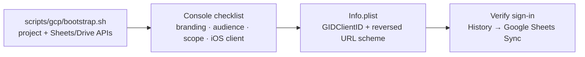

# Connections

How the app talks to services outside the device. Today that means **Google Sheets Sync**. The planned rework of import, export and sync is in [planning/CONNECTIONS.md](planning/CONNECTIONS.md).

## Google Sheets Sync

Sheets Sync is opt-in. Once it's enabled from the History tab's toolbar menu, the app overwrites the entire workout history to a Google Sheet on every add, edit or delete, debounced to 30 seconds. The app creates the sheet in the user's Google Drive the first time sync is enabled, and stores its ID in `AppConfiguration`.

To sign in, the app needs an **iOS OAuth 2.0 client** registered for its bundle ID. The `GoogleSignIn-iOS` SDK keeps the tokens in the iOS Keychain. iOS OAuth clients are public clients that use PKCE, so there is no client secret.

The app requests only the **`auth/drive.file`** scope. It gives access to just the files the app creates, it's **non-sensitive**, and it needs no Google verification. Never add `auth/spreadsheets`: that scope is sensitive and would trigger verification.

### Current client

| | |
|---|---|
| GCP project | `train-ha-prod`, created by [`scripts/gcp/bootstrap.sh`](../scripts/gcp/bootstrap.sh) |
| Publishing status | In production |
| Bundle ID | `com.bradlet.train` |
| Team ID | `CB9HS9S84R` |
| App Store ID | _not set yet: add it to the client once #11 creates the Train App Store Connect record_ |
| Client ID (`GIDClientID`) | `81188376099-3srh0cv25oblvnoukf7n6tvfqemosggn.apps.googleusercontent.com` |
| Reversed scheme (`CFBundleURLSchemes`) | `com.googleusercontent.apps.81188376099-3srh0cv25oblvnoukf7n6tvfqemosggn` |

> The app uses this client from the Train rename (#11) onward; `Train/Info.plist` holds `GIDClientID` and the reversed scheme. The old client in the `thompson-projects` GCP project (Testing mode, registered for `bradlet.Hybrid-AIthletics`) gets deleted once Train is verified on TestFlight (#11 Phase 5). Leave the `thompson-projects` project itself alone, because other things use it.

### Setup



#### 1. GoogleSignIn-iOS package

The `GoogleSignIn` product of `https://github.com/google/GoogleSignIn-iOS` (9.x) is linked to the app target. The sync code is gated behind `#if canImport(GoogleSignIn)`, mirroring the MLX pattern, so the project still builds without it; sync then throws `notImplemented`.

#### 2. Run the bootstrap script

```bash
scripts/gcp/bootstrap.sh                      # project train-ha-prod
PROJECT_ID=some-other-id scripts/gcp/bootstrap.sh
```

The script is idempotent. It creates the project if it's missing and enables the **Google Sheets API** and **Google Drive API** if they aren't already on. Re-running it changes nothing. It passes `--project` on every call, so your active gcloud configuration is never changed. No billing account is needed.

#### 3. Console checklist (gcloud can't do these)

The script prints this checklist with deep links into **Google Auth Platform** for the project:

1. **Branding**: app name *Train*, plus the user support and developer contact emails. Publishing an External app requires all of these; Publish stays disabled until they're set, even if no field shows an error:
   - **App home page:** `https://bradlet.com/train/`
   - **Privacy policy:** `https://bradlet.com/train/privacy/`
   - **Terms of service:** `https://bradlet.com/train/terms/` (a real terms page, not a reused one: Google checks each link is what it claims to be)
   - **Authorized domain:** `bradlet.com`

   All three pages are static HTML in the `bradlet.github.io` repo (`public/train/`), deliberately unlinked from the rest of the site. Keep the privacy policy in step with what the app actually sends off the device.

   The **authorized domain must be verified** in [Google Search Console](https://search.google.com/search-console) first, as a **Domain** property, by an owner of the GCP project. `bradlet.com`'s DNS is on Cloudflare, so the verification TXT record lives there; leave the existing TXT records (SPF for mail, older verifications) in place. The **logo** is the app icon (`scripts/generate_app_icon.py`). With the domain verified, Google's branding verification ran automatically and passed quickly, logo included.
2. **Audience**: user type **External**, then **Publish app** so the status reads **In production**. With only the non-sensitive `drive.file` scope, there's no scope review, and it ends Testing mode's 7-day refresh-token expiry. No test users are needed.
3. **Data access**: add `https://www.googleapis.com/auth/drive.file`, and nothing else.
4. **Clients**: **Create client → iOS**, with the app's bundle ID. Team ID `CB9HS9S84R`. The App Store ID only exists once the App Store Connect record does; add it then. Copy the **Client ID** into [Current client](#current-client).

#### 4. Wire the client into the app

In `Train/Info.plist`:

```xml
<key>GIDClientID</key>
<string>1234567890-abcdef.apps.googleusercontent.com</string>
<key>CFBundleURLTypes</key>
<array>
    <dict>
        <key>CFBundleURLSchemes</key>
        <array>
            <string>com.googleusercontent.apps.1234567890-abcdef</string>
        </array>
    </dict>
</array>
```

The URL scheme is the client ID **reversed**: drop `.apps.googleusercontent.com` and prepend `com.googleusercontent.apps.`. The client's detail page in the console shows the exact value, so copy it from there.

#### 5. Verify

Build and run, then go to **History → toolbar menu → Google Sheets Sync → Enable**. Sign in with any Google account and grant the scope. The app creates a spreadsheet in your Drive and writes the history to it.

### What the user sees in-app

- **Disabled** (the default): the toolbar menu shows **Google Sheets Sync**. Tapping it opens a confirmation explaining that sync is export-only, and confirming runs OAuth, creates the spreadsheet and does the first sync.
- **Enabled, healthy**: the menu shows **Disable Google Sheets Sync**. Changes wait 30 s, then upload silently.
- **Enabled, last sync failed** (a transient network or API error): a red dot appears on the toolbar's `…` icon, and the menu shows **Retry** with the reason.
- **Enabled, but the token is missing or expired**: the menu shows **Sign in to resume Sheets Sync**. This happens on a fresh device or with the Testing-mode 7-day expiry. Signing in again (even over a stale cached session) re-syncs to the **same** spreadsheet; it never creates a new one.
