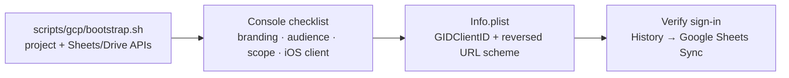
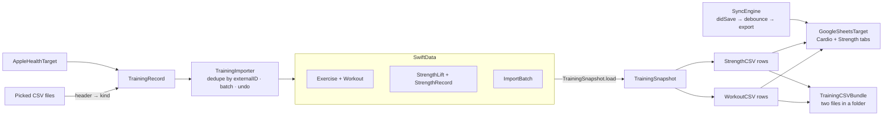
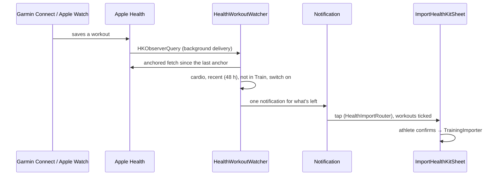

# Connections

How the app talks to services outside the device: Google Sheets sync, CSV export and import, and Apple Health import, all on one connections layer (see [Architecture](#architecture-21)). Design decisions are in [planning/CONNECTIONS.md](planning/CONNECTIONS.md).

## Google Sheets Sync

Sheets Sync is opt-in. Once it's enabled in **Settings → Google Sheets**, the app overwrites a Google Sheet's Cardio and Strength tabs with the whole history on every change, debounced to 10 seconds. The sheet is a read-only mirror: edits made in it are lost on the next sync. The app creates the sheet in the user's Google Drive the first time sync is enabled, and stores its ID in `AppConfiguration`.

To sign in, the app needs an **iOS OAuth 2.0 client** registered for its bundle ID. The `GoogleSignIn-iOS` SDK keeps the tokens in the iOS Keychain. iOS OAuth clients are public clients that use PKCE, so there is no client secret.

The app requests only the **`auth/drive.file`** scope. It gives access to just the files the app creates, it's **non-sensitive**, and it needs no Google verification. Never add `auth/spreadsheets`: that scope is sensitive and would trigger verification.

### Current client

| | |
|---|---|
| GCP project | `train-ha-prod`, created by [`scripts/gcp/bootstrap.sh`](../scripts/gcp/bootstrap.sh) |
| Publishing status | In production |
| Bundle ID | `com.bradlet.train` |
| Team ID | `CB9HS9S84R` |
| App Store ID | `6839394174` (Train: Built to Endure) |
| Client ID (`GIDClientID`) | `81188376099-3srh0cv25oblvnoukf7n6tvfqemosggn.apps.googleusercontent.com` |
| Reversed scheme (`CFBundleURLSchemes`) | `com.googleusercontent.apps.81188376099-3srh0cv25oblvnoukf7n6tvfqemosggn` |

> `Train/Info.plist` holds this client's `GIDClientID` and reversed scheme. It replaced an earlier Testing-mode client in another GCP project, which was deleted when the old app was retired (#11).

### Setup



#### 1. GoogleSignIn-iOS package

The `GoogleSignIn` product of `https://github.com/google/GoogleSignIn-iOS` (9.x) is linked to the app target. The sync code is gated behind `#if canImport(GoogleSignIn)`, mirroring the MLX pattern, so the project still builds without it; sync then throws `notImplemented`.

#### 2. Run the bootstrap script

```bash
scripts/gcp/bootstrap.sh                      # project train-ha-prod
PROJECT_ID=some-other-id scripts/gcp/bootstrap.sh
```

The script is idempotent. It creates the project if it's missing and enables the **Google Sheets API** and **Google Drive API** if they aren't already on. Re-running it changes nothing. It passes `--project` on every call, so your active gcloud configuration is never changed. No billing account is needed.

#### 3. Console checklist (gcloud can't do these)

The script prints this checklist with deep links into **Google Auth Platform** for the project:

1. **Branding**: app name *Train*, plus the user support and developer contact emails. Publishing an External app requires all of these; Publish stays disabled until they're set, even if no field shows an error:
   - **App home page:** `https://bradlet.com/train/`
   - **Privacy policy:** `https://bradlet.com/train/privacy/`
   - **Terms of service:** `https://bradlet.com/train/terms/` (a real terms page, not a reused one: Google checks each link is what it claims to be)
   - **Authorized domain:** `bradlet.com`

   All three pages are static HTML in the `bradlet.github.io` repo (`public/train/`), deliberately unlinked from the rest of the site. Keep the privacy policy in step with what the app actually sends off the device.

   The **authorized domain must be verified** in [Google Search Console](https://search.google.com/search-console) first, as a **Domain** property, by an owner of the GCP project. `bradlet.com`'s DNS is on Cloudflare, so the verification TXT record lives there; leave the existing TXT records (SPF for mail, older verifications) in place. The **logo** is the app icon (`scripts/generate_app_icon.py`). With the domain verified, Google's branding verification ran automatically and passed quickly, logo included.
2. **Audience**: user type **External**, then **Publish app** so the status reads **In production**. With only the non-sensitive `drive.file` scope, there's no scope review, and it ends Testing mode's 7-day refresh-token expiry. No test users are needed.
3. **Data access**: add `https://www.googleapis.com/auth/drive.file`, and nothing else.
4. **Clients**: **Create client → iOS**, with the app's bundle ID. Team ID `CB9HS9S84R`. The App Store ID only exists once the App Store Connect record does; add it then. Copy the **Client ID** into [Current client](#current-client).

#### 4. Wire the client into the app

In `Train/Info.plist`:

```xml
<key>GIDClientID</key>
<string>1234567890-abcdef.apps.googleusercontent.com</string>
<key>CFBundleURLTypes</key>
<array>
    <dict>
        <key>CFBundleURLSchemes</key>
        <array>
            <string>com.googleusercontent.apps.1234567890-abcdef</string>
        </array>
    </dict>
</array>
```

The URL scheme is the client ID **reversed**: drop `.apps.googleusercontent.com` and prepend `com.googleusercontent.apps.`. The client's detail page in the console shows the exact value, so copy it from there.

#### 5. Verify

Build and run, then open **Settings (the gear on any tab) → Connections → Mirror to Google Sheets**. Sign in with any Google account and grant the scope. The app creates a spreadsheet in your Drive with a Cardio and a Strength tab and writes the history to both.

### What the user sees in-app

- **Disabled** (the default): Settings shows **Mirror to Google Sheets**. Tapping it opens a confirmation saying plainly that sync is one-way and overwrites the sheet, so edits made in it are wiped on the next sync. Confirming runs OAuth, creates the spreadsheet (Cardio + Strength tabs) and does the first sync.
- **Enabled, healthy**: Settings shows **Synced** and **Turn Off Google Sheets Sync**. Any save to cardio or strength (picked up from `ModelContext.didSave`) waits 10 s, then uploads both tabs silently. A spreadsheet from before the tabs existed is migrated on its first sync: `Sheet1` becomes Cardio and a Strength tab is added.
- **Enabled, last sync failed** (a transient network or API error): a red dot appears on the Settings gear, and Settings shows **Retry Sync** with the reason.
- **Enabled, but the token is missing or expired**: Settings shows **Sign in to Resume Sync** (and the gear gets a red dot). This happens on a fresh device or with the Testing-mode 7-day expiry. Signing in again (even over a stale cached session) re-syncs to the **same** spreadsheet; it never creates a new one.

## Architecture (#21)

Every import and export goes through one layer in `Train/Services/Connections/`.



| Piece | Role |
|---|---|
| `TrainingRecord` | The interchange model: `.cardio(Cardio)` or `.strength(Strength)`, in internal units, with an `externalID`. |
| `TrainingSnapshot` | Everything an export writes, read once: recorded cardio, every strength record with its lift, the unit preference. |
| `CSVTable` | RFC 4180 tokenizing and escaping, and a header that finds columns by name. |
| `WorkoutCSV` / `StrengthCSV` | Pure codecs, record ↔ rows. Sheets tabs and CSV files use the same rows. |
| `TrainingCSVBundle` | Manual export (two files in one folder) and multi-file import (kind detected per file). |
| `TrainingImporter` | The only import write path: dedupe, `ImportBatch` stamping, Undo. |
| `ConnectionTarget` | Identity and capabilities. `AutoExportTarget` (Sheets; CSV auto-export in #23) and `ImportSourceTarget` (Apple Health; Garmin in #22) refine it. |
| `CSVAutoExportTarget` | Keeps `train-cardio.csv` and `train-strength.csv` current in a folder the athlete picks. The bookmark is device-local (`UserDefaults`). |
| `ConnectionAlert` | Picks the one dismissible Home banner for a paused target. |
| `SyncEngine` | Debounces training saves and exports to every connected auto-export target, owning their `ConnectionStatus`. |

**Rules**

- **`externalID` dedupes imports, nothing else.** It is the source's ID (HealthKit UUID, later a Garmin activity ID), or the app's own UUID for records made here. An import skips any record whose anchor is already present (`Exercise.id`, `Workout.externalID`, `StrengthRecord.id` or `StrengthRecord.externalID`), and the Health picker shows those records as imported. Exports never merge by it: Sheets is overwrite-only.
- **Every import goes through `TrainingImporter`** so it is logged and can be undone. The rows it creates carry `importBatchID`. Undo deletes exactly those rows, plus any lift the import created that is left with no records and no board card.
- **Sync is driven by saves, not call sites.** `SyncEngine` listens for `ModelContext.didSave` touching `Exercise`, `StrengthRecord` or `StrengthLift`. Batch flows (imports, Undo, retry, connect) call `syncNow()` so the mirror updates at once. Keep the `syncNow()` / `performSync()` split: the debounce task calls `performSync()` directly, because routing it through `syncNow()` would cancel the in-flight upload.
- **Apple Health import is always confirmed.** Train notifies about new workouts (below), but only the athlete's tap on Import brings them in.
- **Status is one model.** `ConnectionStatus` is `disconnected`, `connected(lastSync)`, `syncing` or `needsAttention(reason, action)`, where the action is `signIn` or `retry`. The Settings gear's dot reads every auto-export target through `SettingsBadge.forConnections`.

## CSV column reference

Export writes `train-cardio-<date>.csv` and `train-strength-<date>.csv` into a `train-export-<date>` folder. The Sheets tabs carry the same columns. Import reads columns **by header name**, in any order, after trimming, lowercasing, and turning spaces into underscores. A missing column takes its default and an unknown one is ignored. A file whose header has a `lift` column is strength; anything else is cardio.

### Cardio (`train-cardio-*.csv`, Cardio tab)

| Column | Values | Default when missing |
|---|---|---|
| `date` | `M/D/YYYY`, `YYYY-MM-DD` or ISO 8601 (**required**) | none |
| `name` | text | the type's name |
| `type` | short key (`easy`, `long`, …) or display name | `other` |
| `duration` | `1h 30m`, `40m`, `90s`, or plain seconds | 0 |
| `distance` | number, in the unit chosen at import | 0 |
| `notes` | text | blank |
| `feeling` (alias `felt_rating`) | 1–5; blank or 0 = unrated | unrated |
| `perceived_exertion` (alias `rpe`) | 1–10; blank or 0 = unrated | unrated |
| `counts_toward_training` (alias `counts_toward_mileage`) | `true`/`false` | `true` |
| `key_workout` | `true`/`false` | `false` |
| `source` | `Manual`, `CSV`, `Apple Exercise App`, … | `CSV` |
| `id` | dedupe anchor | none (no dedupe) |

A cardio header **without** a `date` column is read positionally in the order above (legacy files).

### Strength (`train-strength-*.csv`, Strength tab)

| Column | Values | Default when missing |
|---|---|---|
| `date` | as cardio (**required**) | none |
| `lift` | lift name (**required** unless `lift_id` is present) | name from `lift_id` |
| `muscle_group` | `Chest`, `Quads`, `Full Body`, … | `Other` |
| `metric` | `weight`, `reps`, `time`, `distance` | from `unit`, else `weight` |
| `value` | number, or `m:ss` for time; blank = done with no number | done |
| `unit` | `lb`, `kg`, `reps`, `s`, `yd`, `m` | the metric's imperial unit |
| `measurement` | `max`, `average`, `firstSet`, `lastSet`, `min` (weight/reps only) | none |
| `light` | `true`/`false`, a light-week session | `false` |
| `notes` | text | blank |
| `counts_toward_training` | `true`/`false`, the lift's opt-out (applied only to a lift the import creates) | `true` |
| `lift_id` | the lift key: a library ID or `name:<name>` | from `lift` |
| `id` | dedupe anchor | none (no dedupe) |

## Connections dashboard (#23)

**Settings → Connections** has a card per connection:

- **Google Sheets:** status, Open Sheet, turn on/off, sign in or retry.
- **CSV:** export the pair, import any mix of files, and auto-export to a folder.
- **Apple Health:** last import, Import now, and the new-workout notification switch.
- **Garmin:** FIT import, and once Garmin Connect writes to Health, "Connected through Apple Health" with its own notification switch.

Below the cards, **Import History** lists recent imports, each with Undo. A target in `needsAttention` puts one banner on Home. Dismissing it holds until the same target fails for a different reason. The Settings gear and the Connections row carry the status dot. Cardio → Progress and Strength → Progress each have a toolbar export for their own file.

## Garmin (#22)

Phase 1 is **FIT file import**: no account, no approval, and it works offline. The athlete picks `.fit` files in **Connections → Garmin → Import FIT Files…**, or opens or shares a file into Train. Info.plist declares `com.garmin.fit` with Train as an alternate viewer, and `TrainApp.onOpenURL` routes file URLs to `ImportFITSheet`.

- `FITDecoder` is a pure decoder for single-value numeric fields. It handles normal and compressed-timestamp headers, both byte orders, developer fields (skipped), invalid sentinels and chained files. It does not check the CRC.
- `FITActivityMapper` turns each `session` message (18) into a cardio record. Duration is `total_timer_time` (moving time), distance is `total_distance`, and the anchor is `fit:<serial>:<time_created>:<session index>`, so re-importing a file adds nothing. Every kind of running maps to plain Run. Key and inclusion come from the athlete's defaults and are never inferred. Strength-training sessions are left out and counted (#36 tracks importing their sets), and so are transitions.
- The zero-effort route is Garmin Connect → Apple Health, with a notification after each activity (see below). The two routes don't recognise each other's anchors, so import an activity through one route only.

Train doesn't call Garmin's APIs (#35, closed). The Activity API is server-to-server, needs a legal entity's approved application, and approvals are paused. The October 2026 personal API key only covers apps the key holder runs themselves. Train has no backend, so Garmin data comes through Apple Health or FIT files.

## New-workout notifications (#37)

When any app saves a cardio workout to Apple Health (an Apple Watch, or Garmin Connect syncing a Garmin activity), Train posts a notification. Tapping it opens the Apple Health import sheet with that workout ticked. Nothing imports until the athlete confirms.



- **On by default, once Apple Health is connected.** The watcher starts from `TrainApp.init` (so a background relaunch has its observer), but only after Health access was requested. It never prompts for Health itself. The first run with Health connected asks for notification permission, and the first fetch only records the anchor, so history never notifies.
- **Garmin is detected, not signed in.** Every Health workout names the app that saved it. A Garmin Connect source marks Garmin connected (`HKSourceQuery` at launch, or the first Garmin workout), and the Garmin card then shows "Connected through Apple Health". Garmin activities keep `WorkoutSource.garmin` on import.
- **Two switches, both on by default:** Apple Health ("new workouts", every non-Garmin source) and Garmin ("new activities"), so Garmin notifications start the moment Garmin is connected. They and the anchor live in this device's `UserDefaults`, never in the synced `AppConfiguration`.
- **Cardio only.** Strength and mobility sessions (`HealthKitWorkoutMapper.nonCardioTypes`) never notify.
- The pieces: `HealthWorkoutObserving` (live on `LiveHealthKitImportService`, `StubHealthWorkoutObserver` for tests), `NewWorkoutNotifying` (`LiveNewWorkoutNotifier` over `UNUserNotificationCenter`), `NewWorkoutNotification` (pure content), `HealthWorkoutWatcher` (`@Environment(\.healthWatcher)`), and `AppDelegate`, which routes taps to `HealthImportRouter`. The entitlement is `com.apple.developer.healthkit.background-delivery`. UI tests pass `-uiTestGarminConnected` to show the connected Garmin card.
