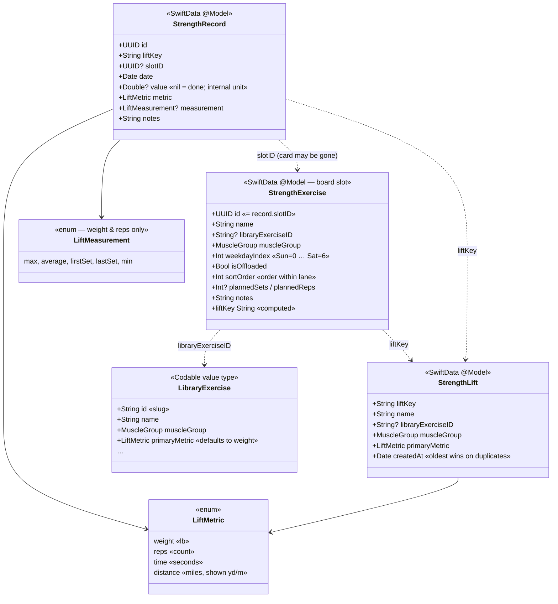
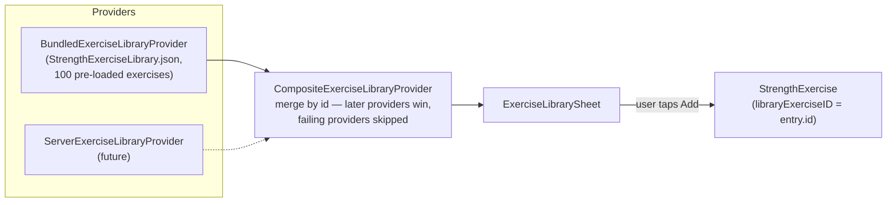
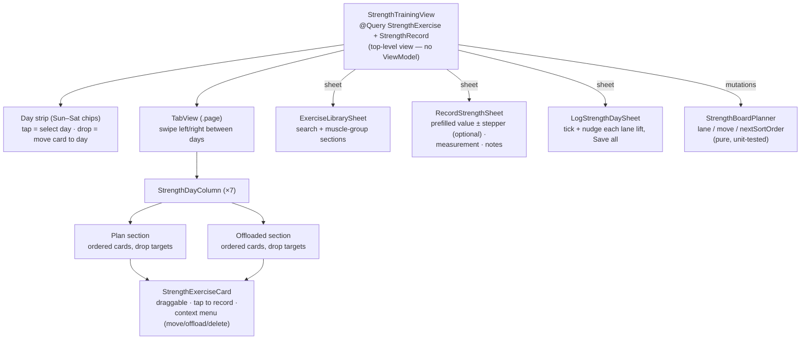
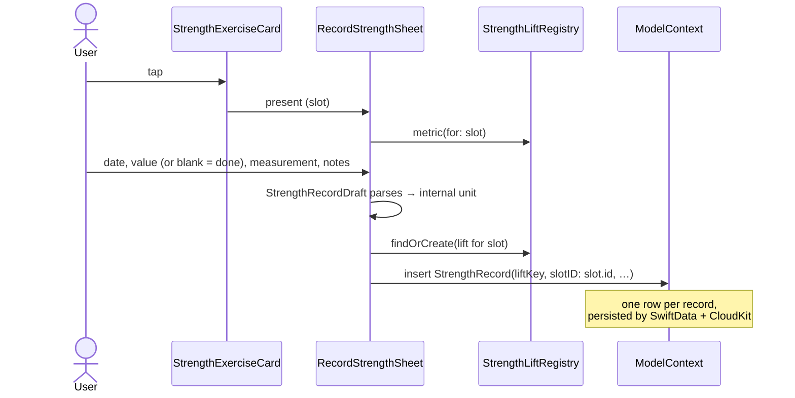
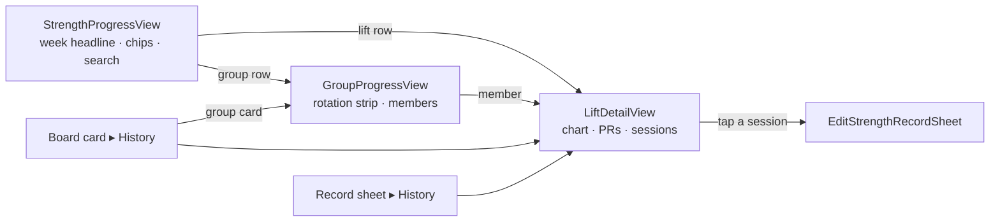

# Strength Training Feature

The Strength tab is a **kanban-style weekly board**. One column per day of the week
(Sunday–Saturday, matching the app's Sunday-start convention), swipeable left/right
like a project management app. Each column has two sections:

- **Plan** — the day's active, ordered exercise list.
- **Offloaded** — a lower holding section for exercises the user regularly does and
  wants to keep in mind, but has dragged out of the current week's plan. Cards can be
  dragged back into the active plan to reorganize workouts.

Unlike aerobic training, **strength exercises are undated**: a card lives permanently in
a day-of-week lane as a *slot* for a lift. History belongs to the **lift**, not the card
(#13): the same lift on two days shares one history, and removing a card keeps it. Each
lift is tracked by one **primary metric** (weight, reps, time, or distance), and a record
is a date, that one number — optional, since "done" with no number is a valid session —
and, for weight and reps, which number it is (max, average, first set, last set, min).

## Data Model

Design notes:

- **Records are rows, linked by keys.** `StrengthRecord` is its own `@Model` so two
  devices logging the same lift both survive a CloudKit sync (a JSON blob on the lift
  would be last-writer-wins). Links are a `liftKey` string and a `slotID` UUID, never
  SwiftData relationships — CloudKit-friendly, and deleting a card can't cascade.
- **`liftKey`** is the `libraryExerciseID`, or `"name:"` + the normalised name for an
  unlinked lift (`StrengthLiftKey.make`). CloudKit can't enforce uniqueness, so
  `StrengthLiftRegistry` resolves duplicate lifts to the oldest; all lookups (lift,
  metric, records, latest-per-lift) go through it.
- **Lifts are created when a card is added** (library sheet, Home's Log Lift, the
  coach's `plan_strength_day`), seeded with the library entry's primary metric; an
  unmatched name gets weight. The record sheet falls back to `findOrCreate`.
- **Each record stores its own metric**, so a later change to the lift's metric never
  reinterprets old values. Values use one internal unit per metric — pounds, a rep
  count, seconds, miles — mirroring the miles-internally convention; `LiftMetric`
  owns display conversion and formatting.
- **No value means "done".** Charts must plot `nil` as a gap, never 0.
- **All model properties have defaults** for CloudKit compatibility.
- `MuscleGroup` decodes unknown raw values to `.other` so newer server catalogs
  can't break older clients. Because of that custom `init(from:)`, SwiftData would
  treat the enum as a composite Codable attribute and **crash its encoder on save** —
  so the models store raw strings (`muscleGroupRaw`, `primaryMetricRaw`, …) and
  expose computed enums, the same pattern as `Workout.source`.

## Exercise Library

The library is **reference data, not user data** — it is never persisted in
SwiftData. Users browse it and add entries to their board, which creates a
`StrengthExercise` carrying a `libraryExerciseID` back-reference.

`ExerciseLibraryProvider` is an async-throwing protocol
(`Services/ExerciseLibrary/ExerciseLibraryProvider.swift`). The app's default is a
composite over just the bundled provider; enabling a server catalog is one line —
append the new provider to the composite's array. Merging is by `id`, with later
providers overriding earlier ones, so the server can both add new exercises and
patch bundled entries.

## View Hierarchy & Interaction

Drag-and-drop semantics (all funneled through `StrengthBoardPlanner.move`):

- **Drop on a card** → insert before that card, in that card's section.
- **Drop on section background** → append at the end of that section.
- **Drop on a day chip** → append to that day's active plan (cross-day moves work
  despite the paged TabView).
- Order within each lane is `sortOrder`, renumbered densely on every mutation.

Child views receive data as `let` parameters and report intent through closures;
only `StrengthTrainingView` owns the `@Query` and `ModelContext` mutations, per the
project's no-ViewModels convention.

## Recording Flow

### Fast recording (#14)

- **Prefill.** `StrengthPrefill` starts every record on the lift's usual measurement —
  its remembered `StrengthLift.defaultMeasurement`, else the latest record's, else
  **Average** (`LiftMeasurement.starting`) — and on the last value logged for it in that
  metric and measurement. Saving a weight or reps record with a value remembers its
  measurement as the lift's default (`StrengthLiftRegistry.rememberDefaults`).
- **Stepper.** `StrengthValueEditor` puts − / + around the value: 5 lb / 2.5 kg, 1 rep,
  15 s, 10 yd / 10 m (`LiftMetric.stepIncrement`). It never steps below one increment;
  blank is how "done" is logged.
- **Log the whole day.** `LogStrengthDaySheet` lists a lane's active cards, prefilled and
  unticked; Save records each ticked row against its card (`StrengthDayLog`). It opens
  from each lane's *Log day* button (dated to that weekday's most recent occurrence,
  `Date.mostRecent(weekdayIndex:)`) and from Home's Log Lift when today has several lifts.

### The weekly loop (#15)

All three rules are pure functions in `Services/Strength/StrengthWeek.swift`, and the
week follows the athlete's week-start setting (`@Environment(\.weekStartDay)`).

- **Checkmarks.** `StrengthWeek.recordsBySlot` gives each card's latest record dated this
  week. A ✓ is per card (its `slotID`), not per lift, so the same lift on two days is
  ticked separately. Cards and Home's rows show the ✓ with that week's value in green, and
  it resets on its own when the week rolls over.
- **Still to do this week.** `StrengthWeek.carryover` lists active cards from lanes earlier
  in the week than today with no record this week, ordered by day and then board order.
  Home → Today shows them beneath today's lifts, each tagged with its day. Tapping one
  records it today against its own card, which ticks it and drops it from the list. The
  board is never changed, and nothing carries across a week boundary.
- **New best.** `StrengthPersonalBest.isNewBest` passes a valued record that beats every
  earlier valued record of the same lift, metric and measurement; higher is better for
  every metric. A first value or a "done" record never counts. Both record sheets report
  bests through `onNewBest`, and Home and the board show a brief banner
  (`.newBestBanner`) with a success haptic, so saving never waits on it.

### Log lifts as planned (#26)

`PlannedDayLogger` (pure, unit-tested) records a lane in one tap, **strength only**.

- **What it logs:** every active card with no record from that card on the day, in board order. Each is valued exactly as the whole-day sheet would prefill it, falling back to "done".
- **Where it appears:**
  - Home: in the **Strength** sub-header. That header now always shows when the button does, so it never sits next to the cardio cards.
  - The board: in each lane. Today's lane logs today, an earlier lane this week backfills its own date, and a day still to come has no button (`logDate(forLane:)`).
- **Toast:** "Logged N lifts · Undo · Adjust" (`.plannedLogToast`).
  - **Undo** deletes exactly the record ids written.
  - **Adjust** undoes the tap, then opens `LogStrengthDaySheet` pre-ticked (`LogStrengthDayRequest.startTicked`) with the same values.
- **Long-press:** "Log with changes…" opens the sheet pre-ticked straight away.

### Movement groups (#24)

A card can plan a **movement** instead of one lift (`StrengthExercise.groupID`).

- **Where groups come from:** ten built-ins ship in `StrengthMovementGroups.json`, keyed by the library's new `pattern` field. The athlete's own groups, and every edit to a built-in (copy-on-write), are `UserMovementGroup` rows. `MovementGroupCatalog.merged` combines them, and `MovementGroupStore` is the only write path.
- **Rotation** is computed from records and never stored (`GroupRotation.assignments`):
  - A card recorded this week shows the member that was done.
  - **Shuffle** picks the least-recently-done member, judged on each lift's global history, and skips members claimed by earlier cards of the group this week.
  - **One per block** holds the member that was least recently done as of the block's start, unless "hold this one instead" overrides it for that block.
- **Recording:** every save path records through `StrengthSlotResolver` → `LiftTarget`, never `slot.liftKey`. Each member is its own lift with its own history and metric. The record sheet's member picker is the swap.
- **UI:**
  - Cards and Home rows show ⟳ and "Up next: …" or "Block N: …".
  - The card menu has Edit Group / Make This a Group (`MovementGroupEditorSheet`).
  - The library has a **Groups** chip.

### Strength → Progress (#16)

- **The list** shows every lift with history, including lifts no longer on the board.
  - `StrengthProgress.summaries` gives each one a sparkline, latest value, best value and last-done date in the lift's own measurement.
  - Lifts are grouped by muscle group, with filter chips and search.
  - Movement groups with history get their own section.
- **The detail chart** has one line per measurement.
  - Lines step at each session, because a number holds until the next one.
  - A "done" session is a gap.
  - Stars mark personal bests (`StrengthProgress.personalBests`, the same rule as the save-time banner).
- **The session list** opens `EditStrengthRecordSheet` (edits go through `StrengthRecordEditor`) and supports swipe to delete.

## AI Coach Serialization

The strength board is part of the coaching snapshot:

- `CoachStrengthWorkout` / `CoachStrengthExercise` — plain Codable snapshots,
  living in the AICoachCore package alongside `CoachWorkout` / `CoachExercise`
  so the Evals CLI shares them.
- `CoachTypeConversions.swift` (app) bridges the SwiftData models to those
  types: `CoachStrengthExercise(from:records:)` (the card's lift history,
  oldest first; empty notes → `nil`) and `CoachStrengthExercise.snapshots(from:records:)`
  (board order). The coach snapshot is still weight-only, so only weight records
  with a value reach it until the coach rework.
- `CoachingRequest.strengthExercises` carries the board into
  `AICoachPromptBuilder`'s "Strength board" prompt section (active lanes only,
  one line per exercise with its sets × reps plan).

The coach can also *plan* strength. Two tools, both weekday-named rather
than dated (the board is a weekly template) and both proposals the athlete
accepts before anything changes:

- `plan_strength_day` — a batch of exercises added to one weekday lane.
  Accepting inserts at the lane end via `CoachProposalApplier`, matching
  names against the merged library for provenance and skipping names the
  active lane already has. A one-item batch is how the coach adds an
  individual exercise; adding appends, never replaces.
- `update_strength_exercise` — one change to one exercise already on the
  board: remove, move to another day (section preserved), offload, or
  onboard. The exercise is addressed by weekday + name, resolved
  case-insensitively; no match or a move-collision fails loudly.

## Feature Plan / Extensibility Notes

Planned extension points, in the order they were designed in:

1. **Server-based exercise library.** Implement a `ServerExerciseLibraryProvider`
   (fetch + decode the same `LibraryExercise` JSON shape) and append it to
   `CompositeExerciseLibraryProvider.default`. Merge-by-id means server data can
   override bundled entries; `MuscleGroup`'s tolerant decoding means new muscle
   groups degrade gracefully to `.other` on old clients. Consider caching the last
   successful server payload so the merged library works offline.
2. **Graphing a lift over time** (#16). `LiftMeasurement` exists so charts can plot
   a top set (`max`) separately from working weight (`average`). Strength → Progress
   can group `StrengthLiftRegistry.records(forKey:in:)` by measurement and feed
   Swift Charts, with value-less records as gaps — no schema change needed.
3. **Richer coach integration.** The board is in the snapshot, and the coach
   can plan a day (`plan_strength_day`) and change individual board exercises
   (`update_strength_exercise`). A natural next step is recording lifts by
   chat — the one write path the coach still can't touch.
4. **Library growth.** The bundled catalog
   (`Resources/StrengthExerciseLibrary.json`, 100 exercises) is a plain JSON array —
   adding entries is a data change, not a code change. `LibraryExercise` keeps
   `equipment`/`difficulty` as free-form strings for forward compatibility.
5. **Richer records.** New `StrengthRecord` / `StrengthLift` fields must be
   optional or defaulted (CloudKit's production schema is additive only) — e.g. the
   per-lift default measurement planned for #14.

## Testing

Unit tests live in `TrainTests/TrainTests.swift`:

- Model defaults, explicit init, Codable round-trips, and SwiftData persistence
  (`StrengthExerciseTests`, `StrengthRecordTests`, `StrengthLiftTests`, enum tests).
- Lift identity and lookups — key normalisation, duplicate resolution, shared
  history across cards, deleting a card keeps records (`StrengthLiftKeyTests`,
  `StrengthLiftRegistryTests`); per-metric value parsing and "done" records
  (`StrengthRecordDraftTests`, `LiftMetricTests`).
- Weight conversion/formatting (`DoubleWeightTests`).
- Library decoding incl. tolerant muscle-group fallback (`LibraryExerciseTests`),
  bundled catalog integrity (≥100 unique entries), and composite merge precedence
  (`ExerciseLibraryProviderTests`).
- Board ordering math — reorder, cross-day, offload round-trips
  (`StrengthBoardPlannerTests`).
- Coach conversion field mapping, ordering, and muscle-group round-trips
  (`CoachStrengthConversionTests`, `CoachTypeConversionTests`), plus
  strength-day proposal application (`CoachProposalApplierTests`).
