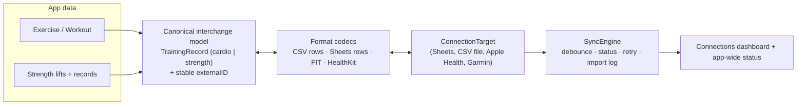

# Connections — Import, Export & Sync Rework (design draft)

> Status: **decided** (2026-11-27); building in #21.

## Where we are today

| Target | Direction | Trigger | Covers strength? | Lives in |
|---|---|---|---|---|
| CSV (`WorkoutCSV`) | import + export | manual, file picker | ❌ | History toolbar menu |
| Apple Health (`HealthKitImportService`) | import | manual, recent workouts | ❌ | History toolbar menu |
| Google Sheets (`GoogleSheetsSyncCoordinator`) | export (overwrite) | automatic, debounced | ❌ | History toolbar menu (status as a menu row) |

**Problems:**
- **Three bespoke pipelines.** Each target has its own row mapping, error type, and UI.
- **Status is hard to see.** A broken Google connection (re-auth every 7 days until the GCP app is published, see #27) shows up only inside a menu.
- **Strength is missing everywhere.**
- **Import is not idempotent.** There are no stable external IDs, so re-importing can duplicate workouts.
- **Wrong home.** The History tab is being folded into Cardio → Progress (see [PROGRESS_VIEWS.md](PROGRESS_VIEWS.md)), so the menu has to move anyway.

## Target architecture



- **`TrainingRecord`** is one canonical, documented interchange type covering cardio workouts and strength records, with a stable `externalID` (source plus source ID, or the app's own UUID) so import can **dedupe**.
- **Codecs** are pure and unit-tested: they convert `TrainingRecord` to and from rows, files, or samples. Sheets reuses the CSV row codec, with one tab each for cardio and strength.
- **`ConnectionTarget`** is a protocol:
  - `id`, `displayName`
  - `capabilities`: `import`, `export`, `autoExport`
  - `status`
  - `connect()`, `disconnect()`, `export(_:)`, `fetchImports()`

  Each target has a live implementation and a stub, following the existing service pattern.
- **`SyncEngine`** generalises `GoogleSheetsSyncCoordinator`'s debounce. It keeps the hard-won `syncNow()` vs `performSync()` split, and extends the status model to `disconnected | connected(lastSync) | syncing | needsAttention(reason, action)`.
- **Import log.** Each import records what it added and offers **Undo last import**.
- **Documentation:** a `docs/CONNECTIONS.md` contributor guide, plus a column reference for the CSV and Sheets format, kept in step with the code.

## Targets

| Target | Import | Export | Auto | Notes |
|---|---|---|---|---|
| Google Sheets | — | ✅ | ✅ | Existing; gains a Strength tab |
| CSV file | ✅ | ✅ | ✅ *new* | Auto-export to a user-chosen Files/iCloud Drive folder (security-scoped bookmark), rewritten on change, the same as Sheets |
| Apple Health | ✅ | — | optional background import | Existing manual import. Writing strength sessions to Health is **out of scope** (decided) |
| Garmin | ✅ | — | phase 2 | See below |

### Garmin import

- **Phase 1: FIT file import.** No approval is needed and it works offline. The athlete exports an activity's original FIT from Garmin Connect, or shares it into the app, and a FIT codec maps it to a `TrainingRecord`. Phase 1 also points athletes to the zero-effort route, because Garmin Connect can already write activities to Apple Health, which we already import.
- **Phase 2: evaluated and not pursued (#35, 2026-11-27).** The [Activity API](https://developer.garmin.com/gc-developer-program/activity-api/) is server-to-server push to a backend, requires a legal entity's approved application, and [new approvals are paused](https://the5krunner.com/2026/09/14/garmin-developer-api-access-paused/). Garmin's [personal API key](https://the5krunner.com/2026/10/22/garmin-personal-api/) (October 2026) is limited to apps the key holder builds and runs, not multi-user apps. Train has no backend and is free, so Garmin data comes through Apple Health, which Garmin Connect already writes to, with a notification after each activity (#37). Revisit only if Garmin opens a client-side, multi-user path.

## Connections dashboard (UX)

The dashboard is reached from Settings → **Connections**. Its status is also surfaced app-wide.

```
CONNECTIONS
┌ Google Sheets        ● Synced 2 min ago      ┐
│ Cardio + Strength tabs · Auto     [Open] [⋯] │
├ CSV auto-export      ● Off                   ┤
│ Keep a CSV copy in iCloud Drive      [Set up]│
├ Apple Health         ● Last import Nov 20    ┤
│                               [Import now]   │
├ Garmin               ○ Not connected         ┤
│ Import FIT files · or via Apple Health [How] │
└──────────────────────────────────────────────┘
IMPORT HISTORY   Nov 20 · 3 workouts from Health   [Undo]
```

- **Needs attention:** a target in `needsAttention` shows a single, dismissible Home banner ("Google Sheets sync paused — sign in again"), plus a badge on the Settings entry. It never shows a modal alert.
- **Manual one-offs:** CSV export and import stay available from the dashboard and from each Progress segment's share menu.

## Decisions (2026-11-27)

1. **Sheets stays overwrite-only.** The app is the source of truth and the sheet is a mirror with one Cardio tab and one Strength tab. The set-up copy says plainly that edits made in the sheet are wiped on the next sync. `externalID` is never used to merge into the sheet. It exists only to stop the same activity being imported, or shown as importable, twice (Apple Health, Garmin, and re-imported CSVs).
2. **Apple Health import stays confirmed by the athlete.** Workouts already imported show as imported in the picker instead of offering themselves again. *Updated by #37:* Train now watches Health in the background, but only to **notify**. A new cardio workout (Apple Watch, or Garmin via Garmin Connect) posts a notification that opens the picker with it ticked. It's on by default once Health is connected, with a separate Garmin switch that is also on by default.
5. **Garmin is cardio only (#36, closed).** Garmin strength sets are not imported; lifts are logged in Strength.
3. **CSV is two files read by header name.** Export writes `train-cardio-<date>.csv` and `train-strength-<date>.csv`. Import detects each file's kind from its header and reads columns by name, so a missing column takes its default and an unknown column is ignored. There is no version line. A cardio file whose header has no `date` column falls back to the legacy fixed column order.
4. **#21 builds the full layer:** `TrainingRecord`, the codecs, the `ConnectionTarget` protocols, `SyncEngine` and the import log with Undo. CSV *auto*-export, as a second auto target, arrives with the dashboard (#23).
