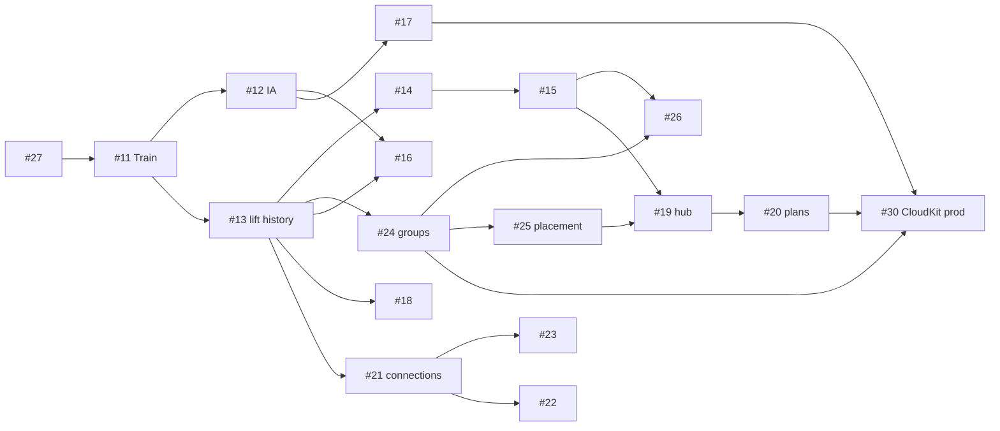

# Execution Plan

One ordered path through everything planned on 2026-11-24. Do one step at a time. Each step is an issue that ships as small conventional commits and leaves the app building. The detail lives in the linked docs and issues.

**Guiding rules:** the Product Vision in `CLAUDE.md` (hybrid by default, low friction, the athlete decides what's hard, strength and cardio quick actions stay distinct). The AI coach is out of scope.

## Plan

### A. Rebrand and infrastructure
1. ✅ **#27** Scripted GCP project and new Google OAuth client, with the consent screen published to production.
2. ✅ **#11** Rebrand to **Train** (*Train: Built to Endure*, [ADR 2](../adrs/2-rebrand-to-train.md)), following its phases in order:
   1. brand discussion and ADR
   2. rename locally
   3. rename the repo
   4. publish to App Store Connect and TestFlight
   5. decommission the old app and repo

   CloudKit syncs in Debug builds only (development environment); Release and TestFlight builds are local-only. Deploying the *production* schema is **#30**, deliberately held to the end of the plan (step 19).

### B. Foundation
3. ✅ **#12** App structure: Home · Cardio (Plan | Progress) · Strength (Plan | Progress). History becomes Cardio → Progress. Docs: [README](README.md), [PROGRESS_VIEWS](PROGRESS_VIEWS.md). Shipped with a Settings gear on every tab, import/export moved into Settings → Data (interim, until #23), and a Strength → Progress placeholder (until #16).
4. ✅ **#13** Lift-owned history, a metric per lift, and records linked to the card they were logged from (`slotID`). Doc: [STRENGTH_ROADMAP](STRENGTH_ROADMAP.md) §1. Shipped as `StrengthLift` + `StrengthRecord` rows; its schema is ready for #30.

### C. Daily strength loop
5. ✅ **#14** Fast recording: prefill, per-lift default measurement, the whole-day sheet (a "done" record with no number already exists, from #13). Doc: [STRENGTH_ROADMAP](STRENGTH_ROADMAP.md) §2
6. ✅ **#15** Current-week checkmarks, missed-lift carryover, PR badge. Doc: [STRENGTH_ROADMAP](STRENGTH_ROADMAP.md) §3. Shipped per card (`slotID`) on the week-start setting; the new best is a brief banner on Home and the board.
7. ✅ **#26** "Log lifts as planned" in one tap, strength only. Doc: [DONE_AS_PLANNED](DONE_AS_PLANNED.md). It values each lift from its last session until plan targets exist; a group card logs its up-next member (#24).
8. ✅ **#24** Movement groups: smart rotation, with a toggle for one member per block. Doc: [MOVEMENT_GROUPS](MOVEMENT_GROUPS.md). Blocks are steady N-week only until #20, and the Progress group view folds into #16.

### D. Progress
8a. ✅ **#31** Chart clean-up before the Progress views reuse it: 1Y (two-week averages) and All (monthly averages) scales, the 6M x-axis "…" bug (a label on every week of alternate months), at most five labels, and per-chart gap styles (mileage zero, feeling dashed bridge). Added here because #16 depends on it.
9. ✅ **#16** Strength → Progress: lift list, lift detail, PRs. Doc: [STRENGTH_ROADMAP](STRENGTH_ROADMAP.md) §4. Shipped with the #24 group view and a week headline. The weekly chart and muscle-coverage parts of P3, and the plan-target step line, wait for later steps.
10. ✅ **#17** Cardio → Progress refactor: training-inclusion opt-in and scoped views. Doc: [PROGRESS_VIEWS](PROGRESS_VIEWS.md). Shipped with #29's CSV column. `countsTowardTraining` is a computed name over the stored `countsTowardMileage`: CloudKit stores refuse property renames, even in development.

### E. Hybrid planning
11. ✅ **#18** Muscle-balance glance and copy day / duplicate card. Doc: [STRENGTH_ROADMAP](STRENGTH_ROADMAP.md) §5. The glance is a five-region strip under the day chips. A copy is skipped when the target day already plans that lift or group.
12. **#25** Run-aware placement: the athlete-marked ⚡ key flag, the key-day strategy (stack or lift-free), and "Arrange my week". Doc: [RUN_AWARE_PLACEMENT](RUN_AWARE_PLACEMENT.md)
13. **#19** Home hybrid hub: week strip and dismissible hints, reusing the rule engine from step 12. Doc: [STRENGTH_ROADMAP](STRENGTH_ROADMAP.md) §6

### F. Training plans
14. **#20** Generic plans (steady ↔ program, cardio, strength, hybrid, presets). This absorbs **#10**. Resolve the doc's §9 open questions first. Doc: [TRAINING_PLANS](TRAINING_PLANS.md)

### G. Connections
This is an independent track. It can run in parallel with any step after step 4, because it needs the strength record format.

15. **#21** Generic import/export layer, covering strength. Doc: [CONNECTIONS](CONNECTIONS.md)
16. **#23** Connections dashboard, sync status, CSV auto-export. Doc: [CONNECTIONS](CONNECTIONS.md)
17. **#22** Garmin import: FIT files first, the API later. Doc: [CONNECTIONS](CONNECTIONS.md)

### H. Release readiness
19. **#30** Deploy the CloudKit production schema and verify two-device sync. **Held on purpose (2026-11-26):** a deployed production schema is additive-only forever, and the backlog still plans model redesigns (#20 plans). #17's rename and #24's groups have landed. Sync isn't needed until then: Release/TestFlight builds are local-only (`ModelContainerFactory.isCloudKitSyncEnabled`). When it's time: reset the development environment, launch a Debug build with `-initializeCloudKitSchema`, check the record types, deploy, flip sync on for Release, and re-check the privacy policy's iCloud wording.

### I. Next brainstorm
20. **Pick the next ideas** from [STRENGTH_IDEAS](STRENGTH_IDEAS.md): S8 self-maintaining board, S2 priority trim, S6 longevity check-ins, S7 power, S3 hybrid load. Design each one, then file an issue for it.

## Dependencies

