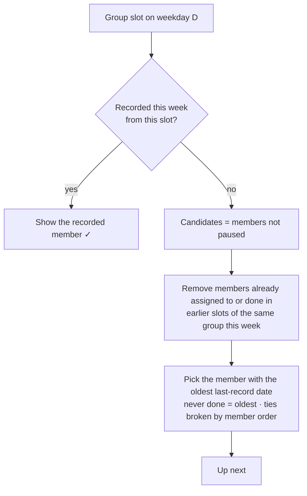
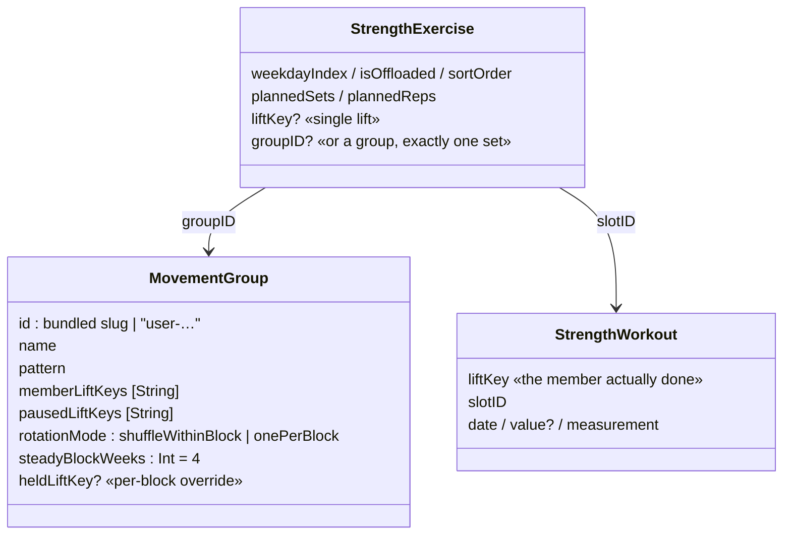

# Movement Groups — Rotating Exercises Within a Movement (design draft)

> Status: **design draft**, iteration 2 (2026-11-24). Realises idea S5 from [STRENGTH_IDEAS.md](STRENGTH_IDEAS.md).
> Builds on the lift-owned history and card-linked records in [STRENGTH_ROADMAP.md](STRENGTH_ROADMAP.md) (F1).

## The idea

Instead of planning "Barbell Bench Press", the athlete plans a **movement**, e.g. **Chest Press**, which contains machine press, dumbbell press, barbell bench, incline dumbbell press, and so on. The board picks which member comes up each session, so variety is automatic and the plan never needs editing to keep it fresh.

**Evidence: rotate systematically, not randomly.**
- A 2022 systematic review found that *systematic* variation can enhance regional hypertrophy and dynamic strength, while *excessive, random* rotation may compromise gains ([Kassiano et al., JSCR](https://pubmed.ncbi.nlm.nih.gov/35438660/)).
- Head-to-head trials (e.g. [Kassiano et al. 2024](https://ro.ecu.edu.au/ecuworks2022-2026/4912)) show fixed and varied routines produce similar results. Variation costs nothing when it's structured, and it helps adherence and boredom.
- Hence **smart rotation**, not a dice roll.

## Decisions

| Topic | Decision |
|---|---|
| Rotation | **Smart rotation.** The least-recently-done member comes up next, so the group cycles predictably. Swap on the spot at any time. |
| Rotation scope | A **per-group toggle**: *Shuffle within a block* (smart rotation every workout, the default) or *One member per block* (hold one member for a whole workout block so it can progress, then rotate when the next block starts). See "Block rotation" below. |
| Within-week variety | If the same group appears on several days, each day gets a different member. |
| History | **Per member, plus a group view.** Each member keeps its own history, prefill, and target, so machine press and barbell bench weights never mix. The group page shows members side by side. |

## How it looks

```
┌ CHEST PRESS ⟳                 3×8 ┐
│ Up next: Incline Dumbbell Press    │
│ Last: 55 lb · Nov 10        [Swap] │
└────────────────────────────────────┘
        after recording ↓
┌ CHEST PRESS ⟳            ✓ 3×8     ┐
│ Incline Dumbbell Press · 60 lb     │
└────────────────────────────────────┘
```

- **The card** shows the group name, the ⟳ group glyph, and the **up-next** member with that member's last value. Tapping it records the up-next member, prefilled from *that member's* last record (or its target).
- **Swap** (on the card and in the record sheet) lists the other members, each with its last-done date and last value, e.g. "bench is taken today". Choosing one opens the record sheet for that member. **No swap state is stored**: recording a different member *is* the swap, and rotation adapts on its own.
- **After recording**, the card shows what was actually done this week (per the weekly-loop ✓).

## Rotation rules (deterministic, nothing stored)

The up-next member is *computed* from records, so there's no rotation pointer to keep in sync across devices through CloudKit.



- **"Last record" uses the lift's global history**, not just this group. If bench was done as a standalone card on Tuesday, the group won't serve bench again on Thursday.
- **Pause a member** (e.g. a shoulder doesn't like barbell pressing right now). It drops out of rotation but keeps its history. Resume it at any time.
- **Group size of 1** behaves exactly like a normal card.

## Block rotation (toggle)

Each group has a **Rotation** setting, shown in the group's settings and in the card's *Plan* menu:

| Mode | Behaviour | Good for |
|---|---|---|
| **Shuffle within a block** *(default)* | Smart rotation every workout, as described above | Accessories, variety, steady plans |
| **One member per block** | The group holds one member for the whole workout block. When a new block starts, the least-recently-done member is chosen for it, using the same rule as above. | Main lifts you want to progress on (the "systematic" variation the research favours) |

- **What is a block?** In a **program** ([TRAINING_PLANS.md](TRAINING_PLANS.md)), it's the program's block or phase, so a change of phase rotates the member. In a **steady** plan there are no phases, so the athlete picks a block length (default **4 weeks**) on the toggle, and blocks count from when the toggle was switched on.
- **Determinism is preserved.** The held member for block *k* is derived from records before that block's start date, so nothing extra is stored. A **swap** during a held block is a one-off and doesn't change the held member. Choosing **Hold this one instead** from the swap list *does* change it, and that is stored as a single `heldLiftKey` override for the current block.
- **Within-week variety is off** in this mode: the same group on Mon and Thu shows the same held member, which is the point.
- **Display:** the card reads `Chest Press ⟳ · Block 2 of 3: Dumbbell Bench`, so it's obvious the member is deliberately held.

## Where groups come from

1. **Built-in groups** ship as bundled JSON (`StrengthMovementGroups.json`), defined by **movement pattern** rather than muscle group, so flys never end up in a press rotation. Library entries gain a `pattern` field. Proposed built-ins, all drawn from the current library:

   | Group | Pattern | Members |
   |---|---|---|
   | Chest Press | horizontal push | Barbell Bench, Incline Barbell Bench, Dumbbell Bench, Incline Dumbbell Press, Machine Chest Press, Push-Up |
   | Overhead Press | vertical push | Overhead Press, Seated DB Shoulder Press, Arnold Press, Push Press |
   | Row | horizontal pull | Barbell Row, Seated Cable Row, Single-Arm DB Row, T-Bar Row, Inverted Row |
   | Vertical Pull | vertical pull | Pull-Up, Chin-Up, Lat Pulldown |
   | Squat | squat | Back Squat, Front Squat, Goblet Squat, Hack Squat, Leg Press |
   | Hinge | hinge | Conventional Deadlift, Romanian Deadlift, Sumo Deadlift, Good Morning, Barbell Hip Thrust |
   | Single-Leg | single leg | Bulgarian Split Squat, Walking Lunge, Reverse Lunge, Weighted Step-Up, Single-Leg RDL |
   | Core | anti-extension / rotation | Plank, Ab Wheel Rollout, Dead Bug, Pallof Press, Side Plank, Hanging Leg Raise |
   | Calves | calves | Standing, Seated, Single-Leg Calf Raise |
   | Power | power | Kettlebell Swing, Power Clean, Medicine Ball Slam, Box/Broad Jump (new entries) |

2. **Custom groups**, created two ways:
   - From the library: **New Group**, then name it and pick members, with same-pattern lifts suggested.
   - From a board card: **Make this a group**, where the card's lift becomes the first member and same-pattern alternatives are suggested.
3. **Editing a built-in** copies it into the athlete's own groups (copy-on-write), so app updates never overwrite their edits.

In the library sheet, groups appear as a **Groups** filter chip and are added to a day exactly like a single lift, with the same sets×reps plan fields.

## Progress (Strength → Progress)

- Groups appear in the lift list next to single lifts, with the ⟳ glyph.
- **Group detail** shows:
  - **one chip per member** with a sparkline, latest value, and best value, each tapping through to the normal lift detail
  - **a rotation strip:** how often each member was done in the last 8 weeks, with never-done members highlighted
  - **the group plan:** sets×reps, paused members, and member order

## Interactions with other features

- **Done as planned** ([DONE_AS_PLANNED.md](DONE_AS_PLANNED.md)) records each group slot's *up-next* member.
- **Run-aware placement** ([RUN_AWARE_PLACEMENT.md](RUN_AWARE_PLACEMENT.md)) reads the group's pattern to tell lower-body from upper-body load.
- **Training plans** ([TRAINING_PLANS.md](TRAINING_PLANS.md)): sets×reps live on the group slot, while weight targets and nudges are **per member**. The nudge for incline DB is about incline DB.
- **Muscle-balance glance:** a group counts toward its pattern and its members' muscle groups.

## Data model sketch



- User groups are a SwiftData `@Model`. Member arrays are stored as JSON `Data`, following the existing `secondaryMuscleGroupsData` pattern and the CloudKit defaults rule.
- A pure, unit-tested `GroupRotation.upNext(slot:groupSlotsThisWeek:records:weekStart:)` holds all the selection logic.

## Open questions

1. ~~Hold one member per block?~~ **Decided:** a per-group toggle between shuffling within a block and one member per block (see "Block rotation"). Still open: should built-in main-lift groups (Squat, Hinge, Chest Press) **default** to one member per block?
2. **Should a pattern-level trend exist at all,** e.g. each member normalised to its own best so you can see whether "Chest Press" is improving overall? It was not chosen this round, so it's parked.
3. **Minimum member count:** is any group with 2 or more members fine, or should we warn below 3 that rotation will feel repetitive?
