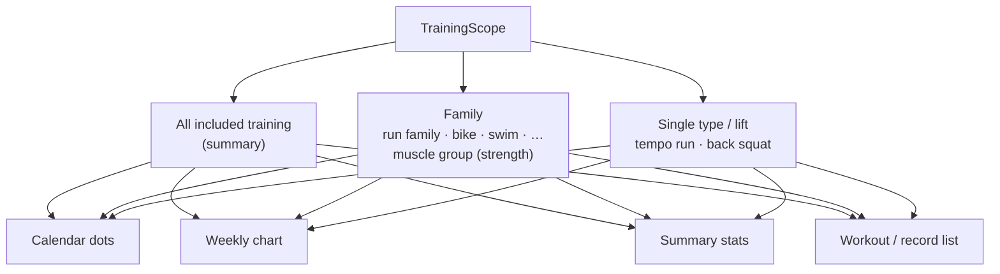

# Progress Views — Consistent History for Cardio and Strength (design draft)

> Status: **design draft**, iteration 1 (2026-11-24). Part of the Cardio / Strength split (see [STRENGTH_ROADMAP.md](STRENGTH_ROADMAP.md) → target IA).

## Goal

The current History tab becomes **Cardio → Progress**, and Strength gains a **Strength → Progress** segment. Both should be built from the **same pieces**, so the two flows feel like siblings:

1. **Training summary**: everything the athlete has opted into "my training", such as total mileage, total time, and sessions per week.
2. **Specific views**: narrow to a family or a single type, such as running only, biking only, tempo runs only, or one lift.

## 1. Opting in: what counts as "my training"

Today each `Exercise` has `countsTowardMileage`, set per workout. That's too granular to be the main control, and it only covers distance.

- **Per-type inclusion defaults** (a new `AppConfiguration` field, edited in Settings → Training):
  - each `ExerciseType` can be **Included** or **Not included**
  - sensible defaults: run family, bike and swim included; walk and hike not included
- **Per-exercise override stays.** A new exercise copies its type's default into `countsTowardMileage`, which can be renamed `countsTowardTraining` when the data is wiped. The hollow dot and the "Not training" badge keep working unchanged.
- **Changing a type's default asks once:** apply it to past workouts, or only to new ones?
- **Strength:** every lift counts by default. A per-lift opt-out (mobility or rehab moves, say) mirrors the cardio flag, and opted-out lifts render hollow and dimmed in the same way.

## 2. One scope, used by every view

A single `TrainingScope` value drives every Progress component: calendar, chart, stats, and list.



- **Scope picker:** a chip row at the top of each Progress segment. In Cardio it reads `All · Running · Bike · Swim · …`, and long-pressing Running drills into `Tempo · Long · Easy · Interval…`. In Strength it reads `All · by muscle group · lift`.
- **Remembered** per segment, so it's sticky between visits.
- **What each scope shows:**
  - **Summary (All):** total distance with a per-type stacked breakdown, total time, sessions, and the weekly mileage chart. Only *included* workouts count.
  - **Family or type:** the same components filtered to that scope, plus type-relevant metrics such as pace trend for running and speed for biking.
  - **Strength lift:** the per-lift chart (one series per measurement, target step line when planned), PR markers, and the record list with edit/delete.
- **Pure helpers.** The filtering is a pure `TrainingScope.filter(_:)` beside the existing `WorkoutAggregations`, unit-tested in the same style.

## 3. Mirrored layouts

```
CARDIO › Progress                     STRENGTH › Progress
[All][Running▾][Bike][Swim]           [All][Legs][Push][Pull][Core][Lift ▾]
┌ This week 24.1 mi · 4 sessions ┐    ┌ This week 6 lifts · 2 days ┐
│ calendar (dots by scope)        │    │ calendar (dots by scope)   │
│ weekly chart                    │    │ weekly lift count / volume │
│ list (10/page)                  │    │ lift list → lift detail    │
```

## 4. Open questions

1. With biking and running mixed, should total mileage be a **headline number** at all, or default to time plus per-type distance?
2. Should Strength → Progress use the same monthly **calendar** as Cardio, or a lighter weekly-adherence grid?
3. Is a muscle-group scope enough for strength, or should it also offer the movement-pattern scope from [STRENGTH_IDEAS.md](STRENGTH_IDEAS.md) S5?
