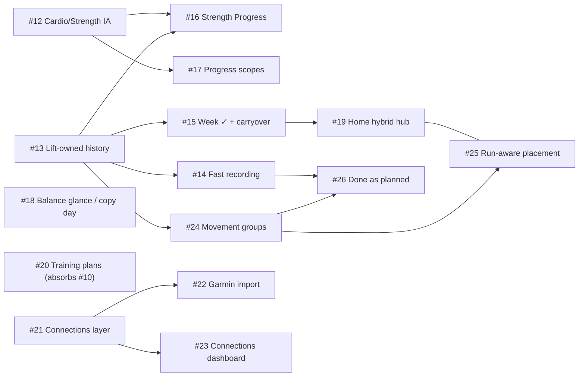

# Feature Planning

Design drafts for upcoming work, in support of the Product Vision in `CLAUDE.md`: consistent **hybrid** training, with strength as a first-class peer. These are living documents. Each one records its decisions, its open questions, and its iteration number.

| Doc | What it covers |
|---|---|
| [STRENGTH_ROADMAP.md](STRENGTH_ROADMAP.md) | Making strength first-class: lift-owned history, fast recording, weekly loop, Strength → Progress, planning aids, Home hybrid hub, hints |
| [TRAINING_PLANS.md](TRAINING_PLANS.md) | Generic plans (cardio, strength, hybrid): steady weeks ↔ multi-week programs, targets and nudges, presets (issue #10) |
| [PROGRESS_VIEWS.md](PROGRESS_VIEWS.md) | Consistent Cardio/Strength Progress segments, the training-inclusion opt-in, summary vs specific scopes |
| [CONNECTIONS.md](CONNECTIONS.md) | Generic import/export/sync, a Connections dashboard, CSV auto-export, Garmin import |
| [STRENGTH_IDEAS.md](STRENGTH_IDEAS.md) | Researched brainstorm of distinctive, simplicity-first strength features |
| [MOVEMENT_GROUPS.md](MOVEMENT_GROUPS.md) | Plan a movement (e.g. Chest Press) whose members rotate automatically (S5) |
| [RUN_AWARE_PLACEMENT.md](RUN_AWARE_PLACEMENT.md) | Strength days placed around the cardio week, plus "Arrange my week" (S1) |
| [DONE_AS_PLANNED.md](DONE_AS_PLANNED.md) | One-tap logging of a whole strength day (S4) |

## Tracking issues

**Target app structure:** Home (Today as the hero, hybrid hub below) · **Cardio** (Plan | Progress) · **Strength** (Plan | Progress).
