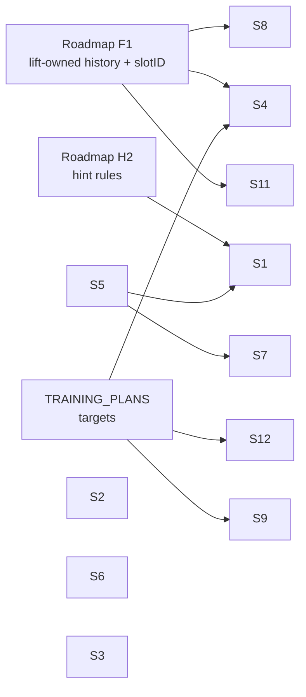

# Strength Ideas — Simple Management Others Don't Offer (brainstorm)

> Status: **brainstorm**, iteration 2 (2026-11-24).
> **Chosen for design:** S1 → [RUN_AWARE_PLACEMENT.md](RUN_AWARE_PLACEMENT.md) (#25) · S4 → [DONE_AS_PLANNED.md](DONE_AS_PLANNED.md) (#26) · S5 (as movement groups with rotation) → [MOVEMENT_GROUPS.md](MOVEMENT_GROUPS.md) (#24).
> Filter: does it make strength **simpler to manage** for someone who also does cardio, and is it **not already done well** by existing apps (Strong, Hevy, Boostcamp, Liftosaur, Fitbod, RP Hypertrophy, the "hybrid" apps such as Edge)?

## What the market looks like

- **Loggers** (Strong, Hevy) are fast at logging sets but have no opinion about the week. **Program libraries** (Boostcamp, 11k+ programs) give you someone else's plan. **Scriptable** tools (Liftosaur) are powerful but ask you to write code. **Generators** (Fitbod) rebuild every workout for you, which takes away ownership of the plan. **Volume/feedback** tools (RP Hypertrophy) are bodybuilding-centric and widely called complicated.
- **Hybrid apps** either hand you a fully generated combined plan (Edge and others) or are running-first and leave strength as a separate plan you manage alongside. Runna is noted as not integrating strength ([findyouredge](https://www.findyouredge.app/news/best-app-for-hybrid-athletes), vendor-biased).
- **Lifters' complaints** centre on taps per set, apps that don't pre-fill from last time, and fiddly editing ([Setgraph roundup](https://setgraph.app/ai-blog/best-workout-tracker-app-reddit), [Product Hunt](https://www.producthunt.com/p/lift-rest-repeat), vendor sources).

**The gap:** nobody takes *the athlete's own* simple strength template and actively fits it around *their own* cardio week, while keeping logging to roughly one tap. Most ideas below aim at that gap.

## Ideas

### S1 — Run-aware placement ("hard days hard")
The board knows your cardio week.
- **Drag guidance:** while dragging a lower-body card, the day chips tint. Green means a day with an athlete-marked key workout (stack it there, key workout first). Amber means the day before a key workout. Neutral means an easy day, which suits upper body and core.
- **Arrange my week:** one tap proposes a lane reshuffle that satisfies the rules. You preview it, then accept.
- **Evidence:**
  - Interference with strength gains appears mainly when the two are close together: under about 20 minutes in one meta-analysis ([PMC8053170](https://pmc.ncbi.nlm.nih.gov/articles/PMC8053170)) and under 3 hours in another ([Examine](https://examine.com/research-feed/study/1PQaW0)).
  - Coaches broadly recommend stacking lower-body strength on hard-run days, run first and a few hours apart, and avoiding heavy legs the day before key runs ([Outside](https://run.outsideonline.com/training/cross-training/how-to-lift-and-run-without-wrecking-either/), [TrainingPeaks](https://trainingpeaks.com/blog/risks-of-concurrent-training/)). Some coaches dissent.
- **Novelty: high.** I found no app that adapts a user-built strength template to a user-built cardio calendar.

### S2 — Lane order is priority: "short on time" and "minimum week"
The board already has an order within each lane. Make it mean *priority*.
- **Short on time:** Home's Today offers *Got 20 min?* and shows only the top cards that fit an estimated duration (from sets×reps). The rest are shown as skipped, not missed.
- **Minimum week:** one switch keeps the top 1–2 lifts of each day for a busy or travel week, and carryover leaves the trimmed lifts alone.
- **Evidence:**
  - 30–60 minutes a week of strength improved recreational runners' performance ([PubMed 28462571](https://pubmed.ncbi.nlm.nih.gov/28462571/)).
  - Strength is maintained for a long time on reduced volume when intensity is kept ([minimal-dose overview](https://pubmed.ncbi.nlm.nih.gov/38509414/)). Trimming to the top, usually heavy compound lifts, matches that.
- **Novelty: medium-high.** Fitbod and MyFitCoach shorten workouts by *regenerating* them ([Fitbod](https://fitbod.me/blog/your-gym-profile/), [MyFitCoach](https://intercom.help/myfitcoach/en/articles/7987339-optimizing-your-training-plan-within-your-available-time)). Trimming *your own* plan in *your own* priority order keeps ownership and needs no algorithm.

### S3 — One hybrid load number (session RPE)
- One optional effort rating for the whole strength day, multiplied by minutes, gives a session load. Cardio already has RPE × duration.
- The weekly **hybrid load** chart shows cardio and strength stacked, plus a gentle hint when load jumps sharply week over week.
- **Evidence:** session RPE is a widely validated, low-burden load measure across sports ([review](https://www.ncbi.nlm.nih.gov/pmc/articles/PMC5673663/)), and holds up in mixed or functional training ([PMC6162783](https://www.ncbi.nlm.nih.gov/pmc/articles/PMC6162783/)). It's less reliable for pure resistance work, so present it as a guide, not a science.
- **Novelty: high for consumer apps.** TrainingPeaks-style load models are cardio-centric. This costs one number per session and builds on the existing `perceivedExertion` field.

### S4 — "Done as planned" in one tap, from anywhere
- A day-level **✓ Done as planned** records every lift in the lane at its target, or its last value when there's no target. You adjust only the exceptions.
- It's available on Home, on the board, and in an **interactive widget / Live Activity checklist**, so lifts can be ticked off between sets without opening the app.
- **Evidence:** taps per set and lack of pre-fill are the top logging complaints (see the market section). With no per-set logging, a whole session can genuinely be one tap.
- **Novelty: medium.** Whole-session completion plus interactive-widget ticking is rare in loggers.

### S5 — Movement patterns, with rotating variants
- **Classify lifts by pattern:** squat, hinge, push, pull, single-leg, carry/core, power. The balance glance and Progress scopes use patterns, which suit hybrid athletes better than bodybuilding muscle groups.
- **Pattern slots (optional):** a card can be "Hinge" and rotate its variant (RDL → KB swing → trap-bar deadlift) per week or per block. Variety comes for free, and the slot's history still reads as one continuous trend.
- **Novelty: medium-high.** Patterns are common in coaching but rare as a first-class concept in apps.

### S6 — Longevity check-ins
- Every 6–8 weeks, a 5-minute **benchmark card** appears in the plan: a 30-second sit-to-stand, a dead hang or grip test, single-leg balance, max push-ups, and a broad jump. Results are tracked over *years* against your own baseline.
- **Evidence:** sit-to-stand, grip strength, and single-leg balance are widely cited functional and longevity markers ([National Geographic](https://www.nationalgeographic.com/health/article/tests-to-measure-how-well-youre-aging), [Les Mills](https://www.lesmills.com/articles/5-diy-tests-for-longevity)). Population claims are mostly associations, so frame results as personal trends, not predictions.
- **Novelty: medium-high.** The Pump app hosts one-off tests. Recurring check-ins built into a training plan are rare.
- **Vision fit: the strongest.** "Performing much later in life" becomes something the athlete can see.

### S7 — A "power" opinion for lifelong athletes
- The balance glance includes **Power**, and the guided presets include one fast movement a week (jumps, med-ball throws, KB swings).
- **Evidence:**
  - Muscle power declines faster with age than strength ([review](https://pmc.ncbi.nlm.nih.gov/articles/PMC4318571)), and power training beats traditional strength training for function in older adults in most comparisons.
  - Heavy and plyometric work also improve running economy, whereas light high-rep work doesn't (see the minimum-dose search results).
- **Novelty: high as a default opinion.** It's cheap to build on top of S5.

### S8 — A board that maintains itself
Because records know which card they came from, the board can notice drift and suggest tidy-ups, each as a dismissible card chip:
- a card **unrecorded for 3 weeks** → suggest *Offload*
- a card **always recorded on another weekday** → suggest *Move to Thursday*
- an **offloaded card recorded twice** → suggest *Back into the plan*

The template stays honest with zero planning effort. **Novelty: high.**

### S9 — Readiness-aware light day
- After a hard or long cardio day (RPE ≥ 8, or a long run), or a low feeling rating, Today offers a **light version** of today's lifts in one tap: one fewer set or about 10% less load, with records tagged as light.
- **Novelty: medium.** Fitbod models muscle recovery, but using *cardio* fatigue as input is a hybrid-only angle.

### S10 — Equipment contexts ("travel mode")
- Switch between *Gym*, *Home*, and *Travel*, and each card swaps to a library equivalent by pattern and equipment for the week. Your history stays per lift.
- **Novelty: low.** Fitbod has gym profiles. It's useful, but it's catch-up, not a differentiator.

### S11 — An estimated-max trend without per-set logging
- Estimate a one-rep max from the recorded weight × the planned reps (Epley) when the measurement implies those reps were done. This unifies mixed measurement types into one "strength trend" line, clearly labelled *estimated*.
- **Novelty: medium.** It gives the payoff of set logging without the logging.

### S12 — Steppers that snap to real weights
- Per equipment, define the increments: barbell plates, dumbbell pairs, machine stack. Steppers and nudge targets never propose a weight you can't load.
- **Novelty: low**, since plate calculators are common, but it's a small delight.

## Scored shortlist

| Idea | Simplicity win | Novelty | Vision fit | Effort | Verdict |
|---|---|---|---|---|---|
| **S1** Run-aware placement | ●●● | ●●● | ●●● | M | **Lead** |
| **S2** Priority trim / minimum week | ●●● | ●● | ●●● | S | **Lead** |
| **S4** Done as planned + widget | ●●● | ●● | ●● | M | **Lead** |
| **S8** Self-maintaining board | ●●● | ●●● | ●● | S | **Lead** |
| **S6** Longevity check-ins | ●● | ●● | ●●● | M | Strong |
| **S5 + S7** Patterns + power | ●● | ●● | ●●● | M | Strong |
| **S3** Hybrid load (sRPE) | ●● | ●●● | ●●● | M | Strong |
| S9 Readiness light day | ●● | ●● | ●● | S | Later |
| S11 Estimated max | ● | ●● | ● | S | Later |
| S12 Snapping steppers | ●● | ● | ● | S | Polish |
| S10 Travel mode | ●● | ● | ● | L | Later |

## Next iteration

- S1, S4, and S5 (movement groups) are designed. Remaining candidates: S8 self-maintaining board, S2 priority trim, S6 longevity check-ins, S7 power, S3 hybrid load.
- Research still open: independent hands-on comparisons of the hybrid apps (Edge, HYBRD, Threshold), whether any of them adapt to a user-built cardio calendar (which would affect S1's novelty), and masters-specific strength volume evidence.
