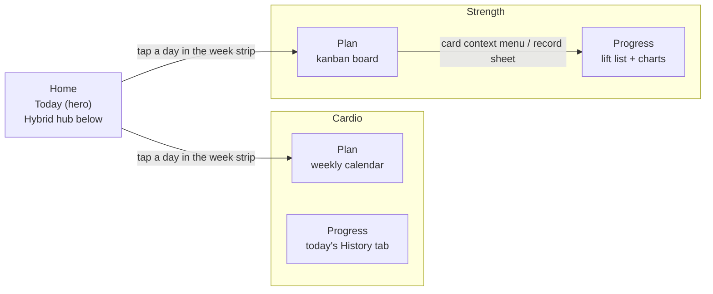
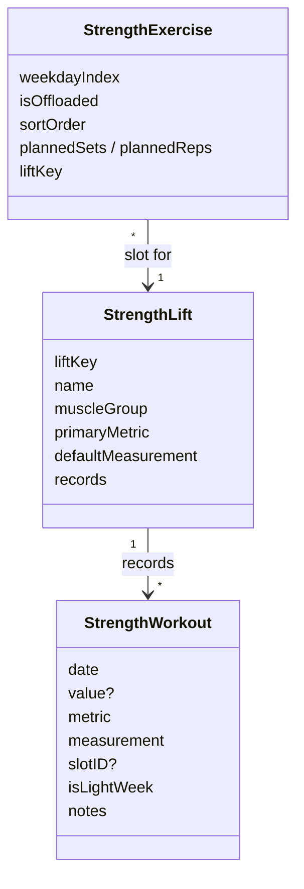
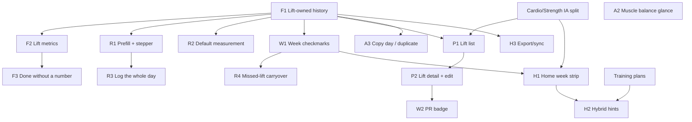

# Strength as a First-Class Peer — Feature Roadmap (draft)

> Status: **brainstorm draft**, iteration 2 (2026-11-24). Nothing here is built yet.
> Related: [TRAINING_PLANS.md](TRAINING_PLANS.md) (templates, targets, light weeks, programs) · [PROGRESS_VIEWS.md](PROGRESS_VIEWS.md) · [CONNECTIONS.md](CONNECTIONS.md) · [STRENGTH_IDEAS.md](STRENGTH_IDEAS.md). The AI coach is out of scope for these docs (it is being reworked separately).
> Guiding belief (see `CLAUDE.md` → Product Vision): consistent hybrid training — aerobic *and* strength — keeps athletes healthier and performing longer. Strength must stop feeling like a bolt-on tab.

## Decisions so far

| Topic | Decision |
|---|---|
| Lift identity | History belongs to the **lift**, not the board card. Cards are slots that point at a lift; removing a card keeps its history. |
| App structure | Two parallel flows, **Cardio** and **Strength**, each with **Plan \| Progress** segments. Today's History tab becomes Cardio → Progress. |
| Home | **Today** is the hero at the top; the **hybrid hub** (week strip + hints) sits further down. |
| Recording | Prefill from last session, log the whole day at once, allow "done" with no number, per-lift default measurement. |
| Lift metrics | Each lift declares one primary metric: **weight, reps, time, or distance**. Still one number per session — no per-set logs. |
| Progression | Trend-only by default. A card with an optional **target** gets subtle, dismissible nudges (see TRAINING_PLANS.md §4). |
| Opinion level | **Guided defaults** — starter templates and gentle hints, all optional. |
| Weekly loop | Cards show a **check for the current week**; **missed lifts carry over**. |
| Gamification | **No streaks.** |
| Card tap | Stays **quick record**; progress detail is one step away. |
| Record ↔ card | A record remembers the **card (slot) it was logged from**, so ✓ is per card and carryover records attach to the missed card. |
| Apple Health | Writing strength to Health is **out of scope**. |
| Hints | **Dismissible** (per hint, per week). |
| Hard workouts | **Athlete-defined** key workouts only, never inferred from type or pace. |

## Target information architecture



---

## 1. Foundation: data model

**F1 — Lift-owned history.** Introduce a lift identity (keyed by `libraryExerciseID`, falling back to a normalised name for un-linked entries) that owns the `StrengthWorkout` records, its primary metric and its default measurement. `StrengthExercise` becomes the board **slot** (day, section, order, planned sets×reps) that references the lift. Removing a slot never deletes history. Wipe the data rather than migrate it (per the existing preference).



**F2 — Lift metrics.** Add `primaryMetric` (weight / reps / time / distance) to the bundled library JSON and to the custom-exercise form. Recording types (Max / Avg / First / Last / Min) apply to weight and reps; time and distance record one value each.

**F3 — Done without a number.** `value` becomes optional. A record with no value means "completed": bodyweight days, or days you just want to tick off. Charts show these as gaps, never as 0 (same rule as feeling/RPE).

## 2. Recording speed

- **R1 — Prefill last session.** The value and measurement prefill from the lift's latest record. A ± stepper nudges the value by a sensible increment (5 lb / 2.5 kg, 1 rep, 15 s, 10 m), so typing is the exception.
- **R2 — Per-lift default measurement.** Remembered from the last record and editable on the lift. Never pick "Max" again for a lift you track as Avg.
- **R3 — Log the whole day.** One sheet lists the day's active lane. Each row has a done tick and a prefilled stepper; **Save all** records everything. Home's "Log Lift" opens this when there's more than one lift, instead of the current picker.
- **R4 — Missed-lift carryover.** Home's Today section adds a "Still to do this week" group: active-plan lifts from earlier days in the current week (by your week-start setting) with no record yet. One tap records them for today. The template never changes, and nothing carries across a week boundary.

## 3. Weekly loop on the board

- **W1 — Current-week checkmarks.** A card recorded in the current week shows a ✓ and that week's value instead of "No records yet" or a stale date. The same applies to Home's strength rows. It resets on its own when the week rolls over.
- **W2 — PR badge on save.** A brief "New best" when a record beats the lift's previous best for that metric and measurement. This is the trend-only motivator.

## 4. Strength → Progress segment

- **P1 — Lift list.** Every lift with history, including lifts no longer on the board. Each shows a sparkline, latest value, best value, and last-done date, grouped by muscle group and searchable.
- **P2 — Lift detail.** A chart with one series per measurement type (no-value records as gaps), PR markers, and a record list with edit and delete. Mirror the `WorkoutDetailSheet` / `WorkoutEditor` pattern. It's reachable from the card context menu and from a chart button on the record sheet.
- **P3 — Strength summary.** Weekly strength days and lifts done, plus muscle-group coverage across recent weeks (counts, not tonnage).

## 5. Planning aids (guided defaults)

- **A1 — Starter templates** → moved to [TRAINING_PLANS.md](TRAINING_PLANS.md) §8 (presets, shared with cardio and hybrid plans).
- **A2 — Muscle balance glance.** A slim header on the board showing which regions this week's active plan covers (push, pull, legs-front, legs-back/posterior chain, core). Missing regions are dimmed.
- **A3 — Copy a day / duplicate a card.** Copy a whole lane to another day, or duplicate one card to another day. Duplicates share the lift's history (thanks to F1).
- **A4 — Light / deload week** → moved to [TRAINING_PLANS.md](TRAINING_PLANS.md) §4–5 (one-off light week in steady mode, scheduled light weeks in programs).

## 6. Hybrid integration

- **H1 — Home two-track week strip** (in the hybrid hub, below Today):

  ```
  THIS WEEK            5 of 9 done
       Su  Mo  Tu  We  Th  Fr  Sa
  Run  --  5mi --  6T  --  4E  14L
  Lift FB  --  UB  --  LB! --  --
  ```

  Each day shows its runs and its lift lane at a glance, with done vs planned. Tapping a cell jumps to that day in the Cardio or Strength Plan. Days carrying hints get a badge.

- **H2 — Hybrid hints engine.** A pure, unit-tested `HybridHints` evaluator over a week of exercises and strength slots/records:
  - **Legs before key workouts**: lower-body lifts the day before a workout the athlete marked as **key**. What counts as hard is entirely athlete-defined (per-session ⚡ toggle plus the athlete's own per-type defaults); the app never infers it. See [RUN_AWARE_PLACEMENT.md](RUN_AWARE_PLACEMENT.md).
  - **Strength frequency floor**: fewer than 2 strength days planned or done this week.
  - **No recovery day**: 7 straight days with training in either discipline.
  - **Muscle-group gaps**: a major region untouched for 2+ weeks.

  Hints appear on the week strip and as a short list in the hybrid hub. Each hint can be dismissed for the week, and a light week relaxes them.

- **H3 — Strength in export/sync**: delivered by the generic connections rework in [CONNECTIONS.md](CONNECTIONS.md). Sheets gets a Strength tab and CSV covers strength records. Apple Health export is out of scope.



## Resolved in iteration 2

1. **What a card's ✓ means:** records carry the `slotID` of the card they were logged from. ✓ is per card, and carryover attaches to the missed card.
2. **Apple Health:** skipped (no strength write-out).
3. **Light weeks and blocks:** expanded into the full plan design in [TRAINING_PLANS.md](TRAINING_PLANS.md).
4. **Hints:** dismissible. The coach is out of scope.
5. **Starter templates:** folded into generic plan presets (issue #10), see [TRAINING_PLANS.md](TRAINING_PLANS.md) §8.
6. **Cardio parity:** Cardio → Progress is refactored to match, with training-inclusion opt-in and summary vs specific views, see [PROGRESS_VIEWS.md](PROGRESS_VIEWS.md).
