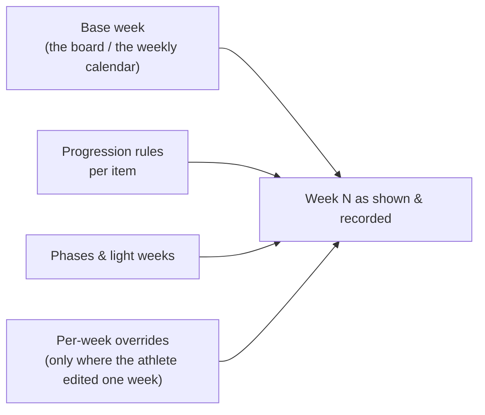
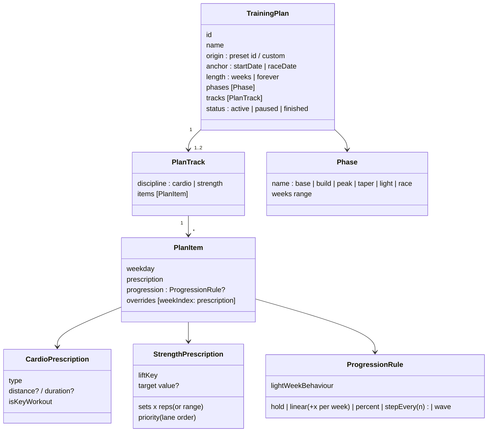

# Training Plans — Steady Weeks to Structured Programs (design draft)

> Status: **design draft**, iteration 1 (2026-11-24). Supersedes the "starter templates" and "light week" items of [STRENGTH_ROADMAP.md](STRENGTH_ROADMAP.md) and generalises issue #10 (race plan presets).
> Vision fit: plans are the main way the app shows its hybrid opinion. A good plan places strength and cardio together, so the user doesn't have to work out how they interact.

## 1. The problem

Athletes manage a plan in one of two ways, and many switch between them over a year:

| | **Steady** | **Program** |
|---|---|---|
| Shape | The same week, repeated indefinitely | A multi-week arc: base → build → peak → taper, or 3 build weeks + 1 light |
| How it progresses | Small, occasional target bumps when the athlete feels ready | Progression decided in advance, week by week |
| Typical user | "I lift Mon/Thu and run 4× a week, always" | "12 weeks to my marathon", "a 6-week strength block" |
| What hurts today | No targets, no memory of how the week has evolved | Not possible at all for strength; cardio only has recurring series |

**The goal:** one plan system where both are first-class and moving between them is a single action that loses nothing. A steady week should grow into a program, and a finished program should settle back into a steady week, with no re-entry.

## 2. Core idea: a plan is a base week plus how it changes

Both modes use the same object. The only difference is the timeline.

- **Steady plan** = a base week that **repeats forever**. Changes are small edits to the base week, made by hand or by accepting a nudge.
- **Program** = a base week stretched over **N weeks**, with a **progression rule** per item, **phases**, and optional **per-week overrides**.

Progression is **computed, not copied**. Week 5's targets come from the base week plus the rules plus any overrides. So editing the base week (swapping a lift, moving a day) flows through every future week, instead of forcing the user to edit eight copies.

A steady plan is simply a program with `length = ∞`, no rules, and no phases. It needs no separate code path.

## 3. Generic across cardio, strength, and hybrid

- **Cardio plan:** one cardio track, for example issue #10's race plans. It generalises `ExerciseSeriesSpec`, whose "every N occurrences" progression is a `ProgressionRule.stepEvery`.
- **Strength plan:** one strength track. **The strength board is this track's base-week editor.** The board doesn't go away; it becomes the plan's face.
- **Hybrid plan:** both tracks on **one shared week axis and one set of phases**, so strength tapers when running peaks without the athlete arranging it.

**How plans reach the calendar:**
- **Cardio** keeps the existing rule that recurring plans are eager inserts of concrete `Exercise` rows. A plan materialises its sessions, tagged with a `planID` (the same way `seriesID` works today), and plan edits regenerate the future, unrecorded rows.
- **Strength** stays template-based. The board shows the **active week**, computed on the fly. Records store `slotID` (decided: a record remembers which card it was logged from) plus `planWeekIndex`, so past weeks can be shown as they were.

> ⚠️ This asymmetry (materialised cardio vs computed strength) is deliberate: cardio sessions are dated objects the user moves around the calendar, while strength is a weekly template. Section 9, question 1 asks whether to keep it.

## 4. Steady mode UX: "my week, gently evolving"

1. **Optional targets per card.** A card can carry a target, such as `185 lb`, `3×8–10`, `12 reps` or `45 s`. With no target, a lift is trend-only, which matches the earlier decision.
2. **Recording against a target** is one glance. The record sheet shows `Target 185 · Last 185` and the stepper starts on the target.
3. **Subtle nudges, never automatic changes.**
   - After the target is met **2 sessions in a row** (default), the card gets a small `↑ 190?` chip. One tap accepts it; a long press offers *Not yet*, which snoozes it for 2 weeks.
   - With a rep range (`3×8–12`): once the athlete records "top of range", the nudge proposes the next weight and resets reps to the bottom. This is double progression without per-set logging.
   - **Stall nudge:** the same target missed 3 times in a row offers *Take a light week?* or *Drop to 175?*, worded gently.
   - Nudges are **dismissible** and appear only on the card and in the record sheet, never as notifications.
4. **Plan changelog.** Every target change is remembered (`Squat 185 → 190, Nov 3`). The lift's progress chart draws the **target as a step line** behind the recorded points, so the plan's evolution and the results sit in one picture.
5. **One-off light week.** *Take a light week* applies a temporary override: targets scaled by about 85–90% or one fewer set, records tagged as light. The next week reverts on its own.

## 5. Program mode UX: "a plan with an arc"

1. **Week header** above the board and the Cardio weekly calendar: `Week 3 of 8 · Build`, with a thin **phase timeline** (base ▮▮ build ▮▮▮ peak ▮ taper ▮). Swipe or tap to preview future weeks. Past weeks are read-only with their records; future weeks show computed targets.
2. **Progression per item**, chosen when building the plan or from a card's *Plan* menu:
   - *Hold* (default for accessories)
   - *Add x per week*
   - *Add x every N weeks*
   - *Percent wave*
   - *Light every Nth week* (default 3:1)

   Presets choose these for you, and most users never open this.
3. **Edit scope**, borrowed from recurring calendar events. Editing a card in a program asks once: **This week only · This and later weeks · Whole plan**. The default is "this and later". The answer decides between an override and a base-week or rule edit.
4. **When life happens**, a missed or partial week is detected when the next week starts. A single non-blocking banner offers:
   - **Repeat the week**, which shifts the remaining plan out by a week. This is the default for strength.
   - **Carry on**, which keeps the dates. This is the default when the plan is anchored to a race.
   - **Make it a light week.**
5. **Finishing a program:** the last week opens a *What next?* card with three choices.
   - **Settle into it.** The final week (with targets taken from actual records) becomes a **steady plan**.
   - **Run it again.** The same program restarts with targets rebased on what was achieved.
   - **Pick the next plan.**

## 6. Fluidity: moving between modes

```mermaid
stateDiagram-v2
    [*] --> Empty
    Empty --> Steady: build on the board / apply a steady preset
    Empty --> Program: apply a program preset
    Steady --> Program: "Make this a block" (choose length + preset progression;<br/>current targets become week 1)
    Program --> Steady: "Settle into it" at the end, or "Stop program"<br/>(current week's computed targets become the base)
    Program --> Program: "Run it again" (rebased) / pick next program
    Steady --> Steady: nudges accepted, edits, one-off light week
    Program --> Paused: injury / travel
    Paused --> Program: resume (shift dates) or restart week
```

**Invariants that make moving between modes safe:**
- Switching modes **never deletes records** and never changes history. Records hang off lifts and slots, not plan weeks.
- **"Stop program" keeps the athlete where they are.** The current week's computed targets become the steady base, so nothing jumps backwards.
- **"Make this a block"** starts from the athlete's *current* targets, so a program never asks them to re-enter weights.
- The board stays the editor throughout. The only visible difference between modes is the week header.

## 7. Hybrid plans: one arc, two disciplines

- **Phase coupling defaults.** These are an opinionated starting point, and every one can be edited.

| Phase | Cardio | Strength default |
|---|---|---|
| Base | Volume building | 2–3×/week, full progression |
| Build | Quality sessions added | 2×/week, progression continues |
| Peak | Key sessions | 1–2×/week **maintenance**: heavy, low volume, no new progression |
| Taper | Reduced volume | 1× light |
| Race week | Race | Optional primer only |
| Light (3:1) | Reduced | Light week, aligned across both tracks |

- **Placement awareness.** Presets mark their key sessions (athletes can change them, since key workouts are always athlete-defined). Building or applying a hybrid plan uses the hint rules from [STRENGTH_ROADMAP.md](STRENGTH_ROADMAP.md) (H2) as placement constraints: lower-body work stacks on key days (key workout first) and stays off the day before key workouts. See idea S1 in [STRENGTH_IDEAS.md](STRENGTH_IDEAS.md).
- **Pairing existing plans.** You can *attach* a strength plan to an active cardio plan (for example, add the "Runner's strength 2×" plan to a 16-week marathon plan). The phases line up by end date, and the strength track adopts the cardio plan's phases.

## 8. Presets (folding in issue #10)

- **One bundled, schema-versioned JSON format for every discipline.** Presets declare their tracks, phases, rules, and parameters.
- **Parameters asked at apply time**, kept to 3 questions or fewer:
  - start date or race date
  - which weekdays are available
  - an optional baseline: current weekly miles for cardio, or "use my recent records" for strength targets
- **First presets** (names are placeholders):
  - **Race plans** (#10): 5k, 10k, half, and marathon, built from the reference books.
  - **Strength:** *Runner's strength 2×* (steady), *Minimum effective dose* (steady, ~20 min), *6-week strength block* (program, 3:1).
  - **Hybrid:** *Half marathon + strength*, and *Base season hybrid* (steady).
- **Apply flow:** pick a preset, answer the parameters, preview the weeks with the phase timeline, then apply. Strength items merge into the board through the existing append-and-skip-duplicates rules, and the athlete can undo the whole application.

## 9. Open questions

> **Decided 2026-11-26** (with #20; any can be revisited):
> 1. **Keep the asymmetry.** Cardio stays materialised; strength stays a computed template.
> 2. **A plan doesn't own the board.** Cards outside a program are extras.
> 3. **One active cardio track and one active strength track.** A hybrid plan fills both.
> 4. **Nudge defaults:** met 2 sessions in a row, then +5 lb upper / +10 lb lower (2.5 / 5 kg), +1 rep, +15 s, or the distance stepper's increment. A stall after 3 misses offers one step down, and *Not yet* snoozes for 2 weeks. Not configurable for now.
> 5. **Light weeks:** targets ×0.9, rounded down to the stepper increment. Presets may override later.
> 6. **`ExerciseSeriesSpec` stays** as the "repeat one session" tool.
>
> **Built in #20 (steady mode):**
> - targets on single-lift cards (Edit Plan), recording that starts on the target, and the nudges above
> - `StrengthTargetChange` as the changelog, drawn as a dashed step line on the lift chart
> - *Take a Light Week* (board ⋯ menu): records are tagged light and the #19 hints relax
>
> **Not yet:** double progression (it needs reps recorded with weight) and targets on group cards. Program mode is #33, hybrid plans are #34, and presets are #10.

1. **Keep the cardio/strength asymmetry?** The alternative is computing cardio weeks on the fly as well. That gives cleaner plan edits but is a big change to the current eager-series design.
2. **Should a plan own the board?** When a strength program is active, should cards outside the plan be allowed? Proposal: yes, as "extras" that aren't part of the plan.
3. **Multiple active plans:** limit to one active plan per discipline, or one hybrid plan? Proposal: one active cardio track and one active strength track, which a hybrid plan fills together.
4. **Nudge thresholds:** are 2 met sessions and +5 lb upper / +10 lb lower (2.5 / 5 kg) the right defaults, and should they be configurable at all?
5. **Light-week scaling:** cut load (~85–90%), cut volume (one fewer set), or let the preset decide?
6. **Is `ExerciseSeriesSpec` absorbed** into `TrainingPlan` over time, or does it stay as the lightweight "repeat this one session" tool?
